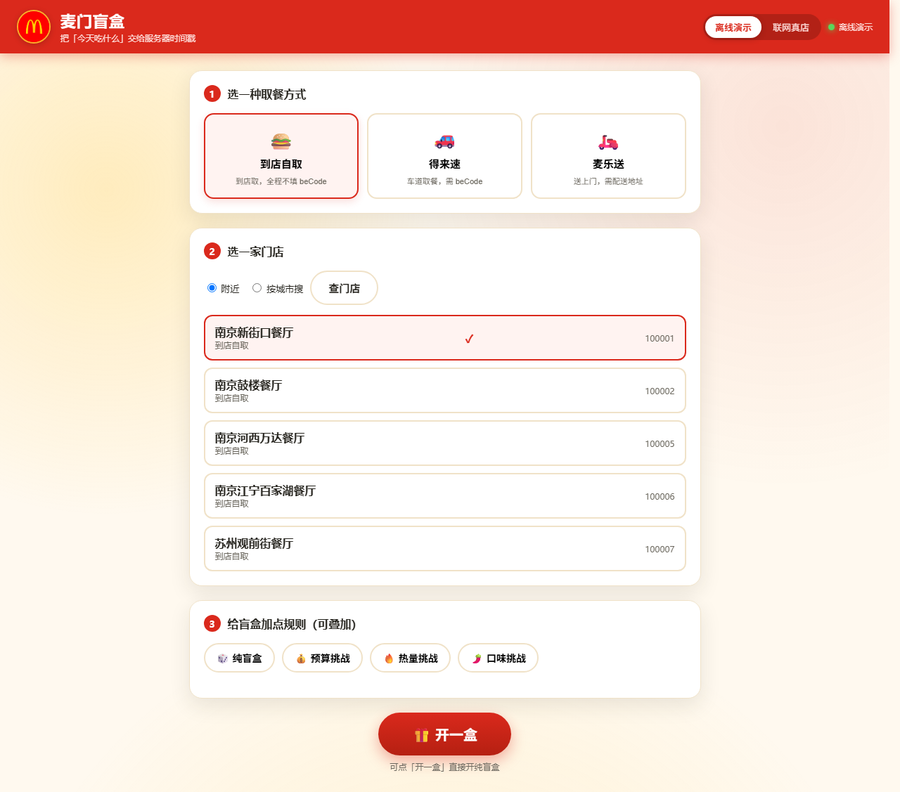
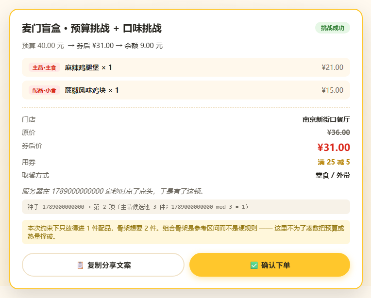

# 麦门盲盒 · mcd-blind-box

> 把「今天吃什么」交给服务器时间戳。  
> 基于麦当劳中国官方 MCP Server（`mcd-mcp`）的可验证开盲盒工具 —— 它真的会算价、用券、下单，但**默认绝不下单**。

一个 WorkBuddy Skill + 一套零依赖 Python 实现。clone 下来就能离线跑通全部流程：不需要 Token、不联网、不产生任何真实订单。

<p align="center">
  <a href="https://mcd-blind-box.app.workbuddy.host/?sharecode=SVSEGRMHHC">
    
  </a>
  <br>
  
  
  
  
</p>

**不用装任何东西，点开就能开一盒 → [mcd-blind-box.app.workbuddy.host](https://mcd-blind-box.app.workbuddy.host/?sharecode=SVSEGRMHHC)**

> 一个盲盒让你会心一笑的话，点个 ⭐ 就是最好的支持 —— 这也是本次比赛唯一的计分方式。

```
【麦门盲盒 · 预算挑战 + 口味挑战（辣）】

预算      40.00 元
实际      券后 ¥31.00  →  余额 9.00 元
状态      挑战成功

主品  麻辣鸡腿堡 × 1
配品  藤椒风味鸡块 × 1（小食）

门店      南京新街口餐厅（到店自取）
原价      ¥36.00
券后价    ¥31.00     使用券：满 25 减 5（满 25.00 减 5.00）
取餐方式  堂食 / 外带（takeWayCode=eat-in）

一句话点评：服务器在 1789000000000 毫秒时点了点头，于是有了这顿。

—— 回复「确认下单」才会真实下单。
   种子 1789000000000 → 第 2 项（主品候选池 3 件；1789000000000 mod 3 = 1）

注意：本次约束下只放得进 1 件配品，骨架想要 2 件。组合骨架是参考区间而不是硬规则 —— 这里不为了凑数把预算或热量撑破。
```

（上面是**真实输出**，不是手写示意：`python -m mcd_blind_box open --offline --mode budget --mode taste --budget 40 --taste 辣 --seed 1789000000000`）

## 界面示例参考

> 以下均为 `python web/server.py --offline` 的实机截图（离线 fixtures 数据），不是设计稿。



<p align="center">
  
  &nbsp;&nbsp;
  
</p>

<p align="center"><sub>首页 → 开盒 → 揭晓：纯静态页面 + 本地桥接后端，零构建、零第三方依赖。</sub></p>

---

## 一、这是什么

一句话：**给「随便点点」这个场景做一个有约束、有惊喜、又完全可复核的决策器。**

用户说「随便来一份」「30 块以内」「要辣的」「不超过 600 大卡」，工具就从这家门店**真实在售**的菜单里抽出一套组合，揭晓为一颗盲盒：算好价、选好券、把「为什么是这一套」用一行可验算的公式写清楚。

|      | 普通随机推荐   | 麦门盲盒                                                     |
| ---- | -------- | -------------------------------------------------------- |
| 随机来源 | 不可解释     | 服务端 `now-time-info` 毫秒时间戳，**可验算**                        |
| 商品来源 | 可能来自模型记忆 | 只能来自 `query-meals` 的真实返回，**编不出来**                        |
| 价格   | 常常是估算    | 走 `calculate-price` + `query-store-coupons`，**分转元后原样展示** |

**四种挑战模式**（可叠加，取交集）：🎲 **纯盲盒** 只看门店在售；💰 **预算挑战** 券后价 ≤ 上限；🔥 **热量挑战** 组合总热量 ≤ 上限（`list-nutrition-foods`）；🌶️ **口味挑战** 餐品名命中口味关键词（辣 / 鸡 / 牛 / 鱼 / 素 / 甜 / 咖啡）。

**三条取餐链路**：到店自取（`beType=1`）、得来速（`5`）、麦乐送（`2`），参数差异见 [`MCP_INTEGRATION.md`](MCP_INTEGRATION.md)。`takeWayCode` 一律取自 `calculate-price` 返回的 `takeWayList[].code`，代码里不硬编码（有测试守着）。

---

## 二、30 秒上手（离线，零依赖）

需要 Python 3.9+，**不需要装任何第三方包**。

```bash
git clone <repo-url> mcd-blind-box && cd mcd-blind-box
python -m mcd_blind_box open --offline --seed 1789000000000          # 开一颗（只读，绝不下单）
python -m mcd_blind_box open --offline --mode budget --budget 30 --seed 7
python -m mcd_blind_box open --offline --mode calorie --calorie-max 600 --seed 3
python -m mcd_blind_box open --offline --scene dt                    # 改用得来速 / 麦乐送：--scene delivery
python -m mcd_blind_box verify --offline                             # 自检：fixtures 齐全 + 证明零第三方依赖
python scripts/smoke_offline.py && python -m unittest discover -s tests -t .   # 20 冒烟 + 410 单测
```

---

## 三、安装

**A. 作为 WorkBuddy Skill 使用（推荐）**

```bash
bash scripts/install_skill.sh                                        # macOS / Linux
powershell -ExecutionPolicy Bypass -File scripts/install_skill.ps1   # Windows
```

脚本把 `skill/mcd-blind-box-challenge/` 复制到 `~/.workbuddy/skills/`，WorkBuddy 自动扫描 `SKILL.md`，**无需注册**。重启对话后即可自然语言触发：「帮我开个 30 块以内的盲盒」「来个不超过 600 大卡的，要辣的」「用麦乐送开一个」。Skill 侧是纯提示词编排（无脚本依赖），规则细节按 `references/` 三级渐进披露读取。

**B. 只用命令行** —— 零依赖，直接在仓库里 `python -m mcd_blind_box ...`，不需要安装。

**C. 联网跑真实门店**（需要 MCP Token，申请：<https://open.mcd.cn/mcp>）

```bash
export MCD_MCP_TOKEN=你的Token          # Windows: set MCD_MCP_TOKEN=...
python -m mcd_blind_box verify --live   # 握手自检，Token 掩码显示
python -m mcd_blind_box open --live --city 南京市 --keyword 新街口
```

Token 只从**环境变量**或 `--token` 读取，代码**刻意不读** `~/.workbuddy/mcp.json` —— 不把宿主凭证耦合进项目。

**D. 网页交互界面**（纯静态页面 + 本地桥接后端，零构建、零第三方依赖）

```bash
cd web
python server.py            # 联网：浏览器打开 http://127.0.0.1:8787/，顶部填 Token
python server.py --offline  # 离线演示：无需 Token，用 fixtures 完整体验
```

「离线演示 / 联网真店」开关的状态由**前端每次请求显式传给后端**（请求体带 `offline` 字段）：以 `--offline` 启动后切到联网并填 Token 会真实联网；未填 Token 明确报错，不静默回退到离线数据。安全上与 CLI 同一套铁律 —— Token 只在内存、开盒全程只读、下单双重门禁（详见第五节）。

---

## 四、为什么随机是可信的

规则来自 [`challenge-rules.md`](skill/mcd-blind-box-challenge/references/challenge-rules.md)，实现逐条对应：

1. 调 `now-time-info()` 拿服务端毫秒时间戳 `ts` 作种子；
2. 候选集按 `productCode` **升序**排序，得到稳定序号 `0 .. N-1`；
3. 主品索引 `i = ts mod N`（N = 主食数量）；
4. 需要配品时用 `floor(ts / N)` 作新种子，在**剔除已选项**的集合里重复取模（第 2 个配品用 `floor(ts / N²)`）；
5. 揭晓卡底部写一行小字：`种子 1789000000000 → 第 2 项（主品候选池 3 件；1789000000000 mod 3 = 1）`。

这一行可验算：同一颗种子重跑一百遍，结果必然一样（`python -m mcd_blind_box open --offline --seed 1789000000000` 跑两次对比即可）。

**两处刻意取舍**（写进代码而不是提示词）：

- **配品优先在非主食类抽。** 照字面实现的话，真实菜单里约四成种子会抽出「两个汉堡」，其中一个还被标成「配品」。只有当非主食为空、或都被约束淘汰时，才回退到含主食的完整集合。
- **组合里不能有样式重复。** 按名称（去规格词，「中薯条」「大薯条」归一）与品类（main/side/drink/dessert）判定；主品若是套餐，其默认子项也计入「已占用样式」。重复候选在**抽取之前**就被剔除，自动换下一件。

**价格口径一致。** 菜单接口对套餐只返回主品挂牌价，算价接口按展开子项后的总价计 —— 实测过「单项之和 ¥19.70 ≠ 原价 ¥26.50」。所以套餐主品的单价会单件探测一次算价接口并回填（按商品缓存、普通单品零额外调用），保证单项价、原价合计、券后价三者同口径。（见 [`docs/live-verification.md`](docs/live-verification.md) 第 4b 节。）

**约束不满足时逐级放宽，且每一步都说出来**：先淘汰不符合约束的候选、只在剩余集合里抽 → 剩余为空则放宽到「最接近约束」并明确告知 → 仍凑不出则给换口味 / 换门店 / 换模式的建议。**禁止**候选集为空时凭记忆编一套「经典套餐」，也禁止假装达到了约束。若约束把原始种子那颗候选筛掉了，卡片会如实标注顺延（`注意：原始种子抽到的组合不满足当前约束，已按步长 7919 顺延到第 5 个候选（种子 31683）。`）。

---

## 五、安全设计：三条硬约束

盲盒的好玩之处在于意外，但**下单不能有意外**。三条约束都写进代码而非提示词。

### 1. 没有 `--confirm` 就绝不会调用 `create-order`

```console
$ python -m mcd_blind_box order --offline --seed 1789000000000
【已拦截】order 子命令会真实下单，但你没有传 --confirm。

建议流程：
  1) 先看揭晓卡： mcd-blind-box open --offline --seed 1789000000000
  2) 确认无误后： mcd-blind-box order --confirm --offline --seed 1789000000000

本项目默认不下单。
```

测试断言被拦截时 `create-order` **一次都没有出现在调用记录里**（不是「没产生订单」，而是「根本没调」）：`backend.write_calls` 开盒后永远是 `[]`，真下单才出现 `["create-order"]` —— 后者反过来证明这个审计不是永远返回空的摆设。离线与联网共用同一份 `Backend` 基类，所以真实端点同样可查。

### 2. 原话判定比 `--confirm` 更严格

同时给了用户原话时，**以原话判定为准**：

| 输入 | 判定 | 理由 |
| --- | --- | --- |
| `确认下单` / `帮我下单` / `买了` | ✅ 确认 | 明确下单意图 |
| `就这个吧` / `行` / `嗯` | ❌ 不确认 | 只是认可内容 |
| `如果可以的话就下单` | ❌ 不确认 | 条件式表达 |
| `多少钱？` / `能下单吗` / `随便` / `再看看` | ❌ 不确认 | 提问、含糊 |

**拿不准一律判为不确认。**

### 3. 写操作与只读操作显式分区

官方 35 个工具切成 **7 个写 + 28 个只读**，两者互不相交且并集等于全集（有测试守着）。`calculate-price` 虽叫「下单前必调」，但只算价不下单，属于只读。

---

## 六、目录结构

```
.
├── mcd_blind_box/               ★ 零依赖 Python 包（枚举 / rules / challenge / coupon /
│                                  pricing / models / backend / transport / pipeline / reveal / cli）
├── skill/mcd-blind-box-challenge/  ★ WorkBuddy Skill：SKILL.md + references/ 五份规则
├── web/                         ★ 网页界面：server.py（标准库桥接）+ index / style / app
├── fixtures/                    离线数据（服务端响应的原样录制，由生成器产出）
├── tests/                       410 个单元测试；scripts/ 为生成器、冒烟、安装与 README 截图脚本
├── docs/                        architecture / live-verification / dialogue / images
├── MCP_INTEGRATION.md           用了哪些工具、怎么串、业务价值
└── CONTEST_DECLARATION.md       参赛声明（官方原文，内容不可改动）
```

> 三层架构与 `backend.py` 接缝设计见 [`docs/architecture.md`](docs/architecture.md)。`workbuddy.md`（专项奖励用）本仓库未包含，如何补交见 `docs/live-verification.md`。

---

## 七、命令行参考

用法：`python -m mcd_blind_box <command> [options]`

| 子命令 | 写操作 | 说明 |
| --- | --- | --- |
| `open` | ❌ 只读 | 定位门店 → 抓菜单 → 开盲盒 → 算价用券 → 输出揭晓卡 |
| `order` | ⚠️ **会真实下单** | 必须显式 `--confirm`，否则直接拦截 |
| `tools` / `verify` | ❌ 只读 | 列工具；离线查 fixtures、联网做握手与鉴权探测 |

主要选项：`--scene {pickup,dt,delivery}`、`--mode {blind,budget,calorie,taste}`（可重复叠加）、`--budget 30`、`--calorie-max 600`、`--taste 辣`、`--seed 1789000000000`（传入即完全可复现）；`--with-mod` / `--json` / `--share`；`--offline`（默认）/ `--live`、`--token` / `--endpoint`。

| 退出码 | 含义 |
| --- | --- |
| 0 / 2 | 成功 / 参数问题（未知口味、到店场景传了 `beCode` 等） |
| 3 | **安全闸拦截**（缺少 `--confirm`，或原话不构成确认） |
| 4 / 5 | 鉴权失败（Token 无效或未提供）/ 触发限流（HTTP 429） |
| 6 | 约束无法满足（候选集为空等） |

---

## 八、测试

```bash
python -m unittest discover -s tests -t .     # 410 个单元测试
python scripts/smoke_offline.py               # 20 条端到端冒烟
python scripts/make_fixtures.py --check       # fixtures 是否与生成器同步
```

最有价值的三组：`TestOrderGate` + `TestNoWriteDuringOpen`（被拦截时 `create-order` 从未出现在调用记录中，真下单时审计必须看得见）、`TestModificationIronRule`（把「含 `unselectedKey` 的整组都要传」拆成 11 个用例钉死）、`test_fixtures.py`（fixtures 被手改而没同步生成器时，这里第一个拦住 —— 否则整组离线测试会在验证一个不存在的世界）。

---

## 九、目标用户

主要面向**想「随便点但又不想踩雷」的普通消费者** —— 痛点是决策疲劳，打开 App 划五分钟不知道吃什么；盲盒把选择成本降到一句话，三种挑战兜住真实约束。其次是**想要一点仪式感的麦当劳重度用户** —— 揭晓卡有点评、可验算种子、可复制分享文案，是个能发朋友圈的「结果」。第三类是**把点餐流程当 Agent 能力演示的开发者** —— 三层架构 + `backend.py` 一个接缝，让同一套业务代码同时跑通「零依赖离线复现」与「真连 MCP」。

---

## 十、已知边界

项目刻意不做的事，写在这里以免被误解：

- **不实现 `beType=6`（企业团餐）。** 参数校验阶段**显式拒绝**，而不是悄悄当成外送。
- **热量拿不到营养数据时不给总量。** 任一项匹配不到 `list-nutrition-foods`，总热量就是 `None`，卡上显示「无法计算」，**绝不按 0 卡或估算值放行**。
- **券相关的三件事都不编。** 无可用券不生成 `couponId`；商品券（如「中薯条买一送一」）抵扣算不出来就按 0 元保守估算并标注「以服务端算价为准」；服务端自己减的钱写成「服务端优惠 ¥0.30（非券来源）」，而不是「无可用券」。
- **多轮套餐（`rounds`）不生成特调。** 它需要发 `roundList`，而该载荷的**结构实测没有被 `calculate-price` 接受**（不报错，但拿不到价格）。没验证过的形状就不猜。
- **骨架是参考区间，不是硬规则。** 约束下放不下配品就少开一件并写明原因，**不为了凑数把约束撑破**；单次只开一份主品 + 可选配品，不一次抽一大桌。
- **`remark` 仅外送链路。** 自取单传备注会**报错**而不是静默丢弃 —— 静默丢弃会让人以为备注写进去了。
- **离线数据是 fixtures，不是真实门店。** 门店名、价格、券都是为可复现而构造的示例，但**响应结构与字段名从真实端点逐字核对**（见 [`docs/live-verification.md`](docs/live-verification.md)）；真实数据只能通过 `--live` 获取。
- **得来速门店按「附近」常常搜不到**（真实数据条件，不是 bug）：改用城市 + 关键词，`python -m mcd_blind_box open --live --scene dt --city 武汉市 --keyword 得来速`。

---

## 十一、合规与声明

- 本项目为「麦当劳程序员节创意开发大赛」参赛作品，原创性、合规性与信息安全声明见 [`CONTEST_DECLARATION.md`](./CONTEST_DECLARATION.md)（该文件为官方原文，内容不可改动）。
- 项目基于 `mcd-mcp`（<https://mcp.mcd.cn>）公开能力开发，**未使用任何非公开接口、未绕过任何鉴权**；仓库内**不含任何真实凭证**（Token 只从环境变量读取，`.gitignore` 排除 `mcp.json` / `.env` / `*.token`，测试里是合成占位串）。
- 营养数据仅作展示参考，**非医疗或健康建议**；商标与商品信息归麦当劳及其关联公司所有，本项目与麦当劳无隶属关系。

## 十二、License

[MIT](./LICENSE)
